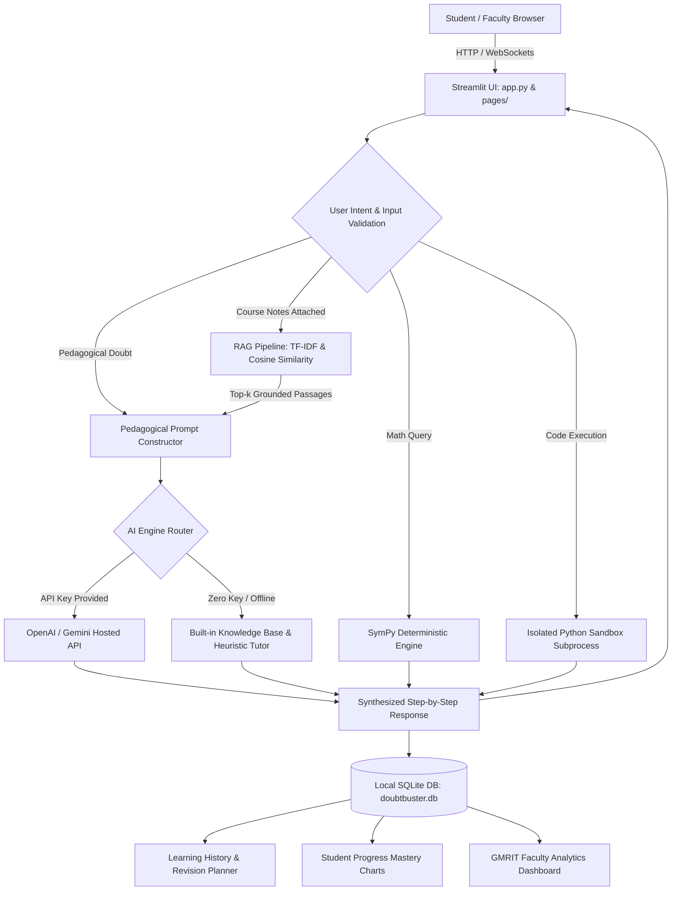

# DoubtBuster — GMRIT Student Doubt-Solving AI Tutor

> **GMRIT Grand AI & NLP Student Projects — Project 14**  
> *Practical Implementation Handbook for GMRIT Students*  
> Department of Computer Science & Engineering, GMR Institute of Technology (GMRIT)

---

### 👥 Project Team Members
| Name | Roll Number | Role |
| :--- | :---: | :---: |
| **M Shanmukha Rao** | `24345A0523` | **Team Leader** |
| **D Sai Praneeth Naidu** | `23341A0570` | **Core Developer** |
| **P Krishna Vamsi** | `23341A05I1` | **Core Developer** |

### 🔗 Project & Live Demo Links
- **GitHub Repository:** [https://github.com/dspnaidudola/DoubtBuster](https://github.com/dspnaidudola/DoubtBuster)
- **GitHub Profile:** [https://github.com/dspnaidudola](https://github.com/dspnaidudola)
- **Streamlit Cloud Profile:** [https://share.streamlit.io/user/dspnaidudola](https://share.streamlit.io/user/dspnaidudola)
- **Live Deployed Application:** [https://doubtbuster.streamlit.app](https://doubtbuster.streamlit.app)
- **Local Application URL:** [http://localhost:8501](http://localhost:8501)

---

DoubtBuster is an educational tutoring platform engineered for GMRIT undergraduate students that transforms passive answer-lookup into active learning through scaffolding hints, intermediate mathematical steps, code diagnostics, isolated sandbox execution, grounded course material RAG, and faculty intervention analytics.

---

## 1. Problem Statement
Undergraduate engineering students at GMRIT frequently encounter conceptual roadblocks when tackling complex topics in programming, calculus, linear algebra, machine learning, deep learning, and NLP outside of scheduled classroom hours. Traditional search engines or generic chat assistants typically dump direct solutions or hallucinated outputs without pedagogical scaffolding, depriving students of the opportunity to develop critical problem-solving skills. Students require a personalized, step-by-step tutor that respects academic integrity, verifies reasoning, connects directly to course notes, and flags difficult topics for classroom discussion.

---

## 2. Objectives
- **Objective 1:** Provide active learning scaffolding through hint-first guidance, step-by-step explanations, and student attempt verification across core engineering subjects.
- **Objective 2:** Offer deterministic mathematical verification via SymPy and safe isolated code execution in a secure sandbox to eliminate hallucinations and verify student code independently.
- **Objective 3:** Implement Retrieval-Augmented Generation (RAG) grounded in uploaded GMRIT lecture notes and PDFs with explicit slide/page citations.
- **Objective 4:** Track learning progress, quiz assessments, and difficult topic flags in a privacy-preserving local SQLite database, generating actionable classroom intervention analytics for faculty.

---

## 3. Features
- **Scaffolding Learning Modes:** Select between *Step-by-step explanation*, *Hint first* (encourages active reasoning without spoiling final answers), *Verify my answer* (reviews student attempts), and *Practice question with answer key*.
- **Supported Academic Subjects:** Programming (Python), Mathematics (Linear Algebra & Calculus), Machine Learning, Deep Learning, Natural Language Processing, and Data Science.
- **Grounded Course Document RAG:** Upload lecture notes and problem sheets (`.pdf`, `.pptx`, `.txt`, `.py`, `.md`) with semantic TF-IDF chunking and direct citations (`[Source: lecture.pdf, Page 3]`).
- **Deterministic SymPy Math & Matrix Engine:** Exact algebraic solutions ($f(x) = 0$), symbolic derivatives, indefinite integrals, limits, matrix determinants, and eigenvalue/eigenvector decompositions with live LaTeX rendering.
- **Safe Python AST Auditor & Isolated Sandbox:** Static code analysis for syntax errors and logical anti-patterns, combined with an isolated subprocess sandbox enforcing a 3.0-second timeout.
- **Interactive Practice Quizzes & Coding Challenges:** Auto-graded multiple-choice assessments with answer explanations, plus live coding challenges validated against automated test cases.
- **Personalized Revision Planner:** Topics flagged as difficult by students are recorded in SQLite and organized into targeted revision checklists.
- **GMRIT Faculty Analytics Dashboard:** Aggregates student doubt volumes, topic confusion heatmaps, and automatically generates lecture intervention recommendations for professors.
- **Multilingual Support:** Select between English, Simple English, Telugu (Technical mix), and Hindi (Technical mix).
- **Zero-Config Built-in Pedagogical Mode:** Fully operable offline with pre-indexed engineering knowledge bases, requiring zero paid API keys.

---

## 4. Technology Stack
- **Language & Runtime:** Python 3.11 / 3.12 / 3.13
- **Frontend Framework:** Streamlit (v1.36+) with custom CSS design tokens
- **Data Visualizations:** Plotly Express & Pandas
- **Symbolic Mathematics:** SymPy (v1.14+)
- **Document Processing:** PyPDF (v4.0+), Python-PPTX (v1.0+)
- **Retrieval & RAG:** Scikit-Learn (TF-IDF Vectorizer & Cosine Similarity)
- **Local Persistence:** Python SQLite3 (`doubtbuster.db`)
- **AI Providers:** OpenAI API (`gpt-4o-mini`), Google Gemini API (`gemini-2.5-flash`), or Built-in Offline Mode
- **Test Suite:** Pytest

---

## 5. Architecture


**Workflow Summary:**
1. **Input & Validation:** Student submits question, optional attempt, and optional document (`.pdf`, `.pptx`, `.txt`, `.py`). Inputs are checked by `backend.utils.validators`.
2. **Context Routing:** Mathematical queries are verified via SymPy; code is audited via AST and tested in the isolated sandbox.
3. **Retrieval Grounding:** If notes are uploaded, the RAG service extracts text, builds TF-IDF vector embeddings, and injects retrieved passages with source citations.
4. **Pedagogical Generation:** Prompts are structured based on the chosen mode (Hint first vs. Step-by-step), calling OpenAI, Gemini, or the offline tutor.
5. **Persistence & Insights:** Interactions are logged to SQLite, feeding the student's mastery matrix and the faculty intervention dashboard.

---

## 6. Project Structure
```
DoubtBuster/
├── app.py                      # Main Streamlit entry point (Doubt Solver, Math Verifier, Code Sandbox)
├── pages/                      # Multipage application convention
│   ├── 1_Learning_History.py   # Persistent query logs, difficult topic revision planner, JSON/MD export
│   ├── 2_Practice_Quiz.py      # Interactive MCQ quizzes and live coding challenges with test cases
│   ├── 3_Study_Materials.py    # Curated topic cheat sheets, PDF/PPTX explorer, and student notebook
│   ├── 4_Student_Progress.py   # Plotly mastery analytics, streak counter, and privacy controls
│   └── 5_Faculty_Dashboard.py  # Cohort metrics, topic confusion heatmap, and classroom intervention tips
├── components/                 # Reusable UI component pieces (cards, badges, layouts)
│   ├── __init__.py
│   └── ui_cards.py
├── backend/                    # Core business logic (no UI code)
│   ├── __init__.py
│   ├── config.py               # Reads st.secrets and local .env variables
│   ├── core/
│   │   ├── __init__.py
│   │   └── pipeline.py         # Prompt orchestration, adaptive logic, quiz/coding generators
│   ├── services/
│   │   ├── __init__.py
│   │   ├── db_service.py       # SQLite database operations (history, quizzes, notes, analytics)
│   │   ├── llm_service.py      # OpenAI, Gemini, and offline pedagogical engine
│   │   ├── offline_tutor.py    # Universal domain-grounded pedagogical synthesizers
│   │   ├── math_code_service.py# SymPy calculus/algebra solver and AST static syntax auditor
│   │   ├── code_exec_service.py# Isolated Python execution sandbox with test assertions
│   │   ├── rag_service.py      # Document parser (PDF/PPTX), TF-IDF vector retrieval, citations
│   │   └── doc_service.py      # Engineering cheat sheets and text extraction helpers
│   └── utils/
│       ├── __init__.py
│       └── validators.py       # Empty input and character limit guardrails
├── data/
│   └── sample/                 # Synthetic sample files for testing doubts and RAG
│       ├── sample_python_code.py
│       ├── sample_linear_algebra.txt
│       └── sample_machine_learning_notes.md
├── docs/                       # Project documentation, test reports, and presentation slides
│   ├── project_report.md
│   ├── test_report.md
│   ├── presentation_slides.md
│   ├── architecture.md
│   └── system_design.md
├── assets/                     # Verification screenshots and system diagrams
│   ├── screenshot_home.png
│   ├── screenshot_answer.png
│   └── screenshot_tabs.png
├── tests/                      # Automated unit test suite (32 unit tests)
│   ├── test_pipeline.py
│   ├── test_validators.py
│   ├── test_db_service.py
│   ├── test_math_service.py
│   └── test_rag_code_exec.py
├── conftest.py                 # Pytest workspace discovery configuration
├── requirements.txt            # Pinned dependencies for deployment
├── .env.example                # Template for environment variables
├── .gitignore                  # Prevents secrets, virtualenvs, and DBs from being committed
└── LICENSE                     # Open source educational license
```

---

## 7. Prerequisites
- Python 3.11, 3.12, or 3.13 installed
- Git installed
- *(Optional)* An OpenAI API key or Google Gemini API key. If omitted, DoubtBuster runs in Built-in Offline Mode with full functionality.

---

## 8. Installation
```powershell
# 1. Clone the repository
git clone <repository-url>
cd DoubtBuster

# 2. Create and activate a virtual environment
py -3.12 -m venv .venv
.venv\Scripts\Activate.ps1

# 3. Upgrade pip and install dependencies
python -m pip install --upgrade pip
pip install -r requirements.txt

# 4. Copy the environment template
copy .env.example .env
```

---

## 9. Run the Application
Start the Streamlit application from the project root:
```powershell
streamlit run app.py
```
The application will launch automatically at: **`http://localhost:8501`**.

---

## 10. How to Use
1. **Ask an AI Doubt:** On the home page, select your Subject, Topic, and Skill Level. Click one of the quick concept chips or type your own question. Optionally attach a code file or lecture PDF.
2. **Review Explanations:** Examine the step-by-step guidance, math calculations, and visual Mermaid diagrams.
3. **Ask Follow-ups:** Use the follow-up text field to ask clarifying questions within the same thread.
4. **Flag Difficult Topics:** Click **"📌 Flag Difficult"** to add challenging concepts to your revision planner.
5. **Verify Math & Code:** Use the **Instant Math Verifier** tab to calculate exact derivatives, integrals, or matrix eigenvalues. Use the **Python Code Diagnoser & Sandbox** to run code in an isolated environment.
6. **Practice & Assessments:** Navigate to **Practice Quiz** to take multiple-choice quizzes or write solutions to live coding challenges evaluated against test cases.
7. **View Faculty Analytics:** Navigate to **Faculty Dashboard** to review cohort difficulty flags, topic confusion metrics, and suggested lecture topics.

---

## 11. Configuration
DoubtBuster loads settings from `.streamlit/secrets.toml` (on Streamlit Cloud) or a local `.env` file:
| Environment Variable | Description | Default |
| :--- | :--- | :--- |
| `LLM_PROVIDER` | Preferred provider (`auto`, `openai`, `gemini`) | `auto` |
| `OPENAI_API_KEY` | OpenAI API Key (starts with `sk-...`) | None |
| `OPENAI_MODEL` | OpenAI Model Name | `gpt-4o-mini` |
| `GEMINI_API_KEY` | Google Gemini API Key (starts with `AIza...`) | None |
| `GEMINI_MODEL` | Gemini Model Name | `gemini-2.5-flash` |

*Note: You can also enter and test API keys directly in the web UI sidebar at runtime.*

---

## 12. Testing
Run the complete automated test suite (32 unit tests):
```powershell
pytest
```
**Test Coverage Summary:**
- `tests/test_validators.py`: Input validation, character limits, empty inputs.
- `tests/test_pipeline.py`: Pedagogical prompt generation, multi-turn follow-ups.
- `tests/test_math_service.py`: SymPy derivatives, integrals, matrix eigenvalues, AST static code auditing.
- `tests/test_code_exec.py`: Isolated sandbox execution, timeout handling, unsafe pattern blocking.
- `tests/test_rag_code_exec.py`: TF-IDF chunking, cosine retrieval, citation grounding.
- `tests/test_db_service.py`: SQLite persistence, difficult topic tagging, quiz results, faculty analytics, and privacy purge.

---

## 13. Screenshots / Demo
- **Live Demo App:** [https://doubtbuster.streamlit.app](https://doubtbuster.streamlit.app)
- **Streamlit Cloud Dashboard:** [https://share.streamlit.io/user/dspnaidudola](https://share.streamlit.io/user/dspnaidudola)
- **GitHub Repository:** [https://github.com/dspnaidudola/DoubtBuster](https://github.com/dspnaidudola/DoubtBuster)
- **Local Interactive Demo:** Run `streamlit run app.py` and open **`http://localhost:8501`**
- **Repository Visual Assets:**
  - `assets/screenshot_home.png`: Gemini-style home dashboard with suggestion chips and streak tracking.
  - `assets/screenshot_answer.png`: Domain-accurate step-by-step pedagogical guide with mathematical equations and takeaways.
  - `assets/screenshot_tabs.png`: Instant Math Verifier, Python Code Diagnoser, and Sandbox execution tools.

---

## 14. Known Limitations
- **Sandbox Environment:** Code execution sandbox is restricted to Python; C/Java/C++ code is analyzed statically.
- **Scanned Image PDFs:** PDFs containing scanned images without OCR text require pre-extracted text layers.
- **Cloud Ephemeral Storage:** On Streamlit Community Cloud free tier, SQLite files reset upon app restart; users can download their JSON/Markdown backups anytime.
- **AI Verification:** AI-generated text may occasionally contain inaccuracies. Students must verify important engineering calculations using the built-in SymPy engine.

---

## 15. Privacy and Responsible Use
- All personal student doubts, notes, and quiz histories are stored strictly in the student's local SQLite database (`doubtbuster.db`).
- No personal student identification (names, registration numbers, credentials) is transmitted to external servers.
- A 1-click **"Purge All My Data"** option is provided under **Student Progress** for complete privacy compliance.
- DoubtBuster is designed to support academic comprehension and must not be used to submit unverified AI-generated text as original coursework.

---

## 16. Future Enhancements
- Integration with GMRIT Moodle / LMS for automated assignment doubt sync.
- Speech-to-text voice input for students to speak doubts in regional languages.
- Containerized Docker sandboxing for multi-language execution (C, C++, Java).
- ChromaDB / FAISS persistent vector store integration for multi-gigabyte departmental textbook libraries.

---

## 17. Credits, Team & License
### 👥 Project Team (GMRIT CSE Students)
- **M Shanmukha Rao (Team Leader)** — Roll No: `24345A0523`
- **D Sai Praneeth Naidu** — Roll No: `23341A0570`
- **P Krishna Vamsi** — Roll No: `23341A05I1`

- **Institution:** Department of Computer Science & Engineering, GMR Institute of Technology (GMRIT), Rajam, Andhra Pradesh
- **Curriculum:** GMRIT Grand AI & NLP Student Projects (Project 14 Handbook)
- **GitHub Organization / User:** [@dspnaidudola](https://github.com/dspnaidudola)
- **Streamlit Cloud:** [dspnaidudola](https://share.streamlit.io/user/dspnaidudola)
- **Licensed under:** [MIT License](LICENSE)
