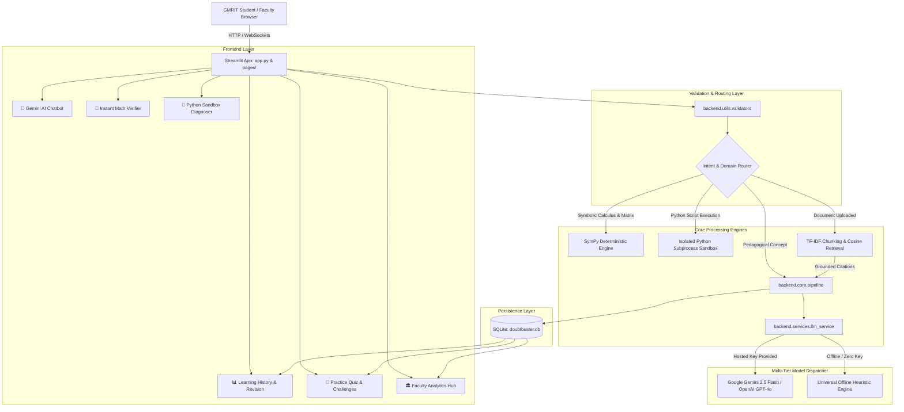

# DoubtBuster — Architecture & Technical Specifications

**Project 14:** DoubtBuster — GMRIT Student Doubt-Solving AI Tutor  
**Deployment Platform:** Streamlit Community Cloud (Single-Deployment Architecture)

---

## 1. High-Level System Architecture

DoubtBuster is architected as a modular, layered educational platform. The presentation layer is decoupled from business logic and mathematical verification services:

---

## 2. Layered Responsibilities

| Architectural Layer | Components | Key Responsibilities |
| :--- | :--- | :--- |
| **Presentation (Frontend)** | `app.py`, `pages/*.py`, `components/` | Renders conversational UI, Markdown, KaTeX LaTeX math, interactive Plotly charts, and file upload forms. |
| **Input Guardrails** | `backend.utils.validators.py` | Enforces character limits (<12,000 chars), non-empty validation, and supported MIME file types (`.pdf`, `.pptx`, `.txt`, `.py`, `.md`). |
| **Deterministic Engines** | `backend.services.math_code_service.py`, `code_exec_service.py` | Calculates exact derivatives, integrals, limits, and matrix properties using SymPy. Audits Python AST syntax trees and runs user code in an isolated subprocess with a 3.0s timeout. |
| **RAG Knowledge Engine** | `backend.services.rag_service.py` | Parses uploaded GMRIT lecture notes, segments them into overlapping token chunks, computes TF-IDF representations, and retrieves top-$k$ grounded passages with slide citations. |
| **Pedagogical Pipeline** | `backend.core.pipeline.py` | Structures prompts according to selected mode (*Step-by-step*, *Hint-first*, *Verify my attempt*), applies adaptive difficulty based on quiz scores, and generates practice questions. |
| **AI Dispatcher** | `backend.services.llm_service.py`, `offline_tutor.py` | Routes queries to Google Gemini or OpenAI when API keys are available, and gracefully falls back to the built-in offline dynamic pedagogical engine. |
| **Persistence Layer** | `backend.services.db_service.py` | Manages local SQLite storage for doubts, bookmarks, difficult flags, quiz histories, and faculty intervention heatmaps. |

---

## 3. Data Flow Workflow

1. **Submission:** The student types an academic query or uploads lecture notes.
2. **Validation:** `validate_question` ensures the input is non-empty and within bounds.
3. **Intent Detection:**
   - Pure math expressions ($f(x) = 0$, derivatives, integrals) are passed to the SymPy symbolic engine.
   - Code execution requests are analyzed via Python AST and executed in the secure sandbox.
   - Conceptual queries trigger automatic domain classification (`detect_academic_field`).
4. **Augmentation:** If a course document is attached, `retrieve_grounded_chunks` extracts relevant excerpts and appends source citations.
5. **Synthesis:** The pedagogical engine synthesizes a structured step-by-step response with definitions, mechanisms, and key takeaways.
6. **Logging:** The doubt is logged into `doubtbuster.db` for student review, streak tracking, and faculty analytics.
