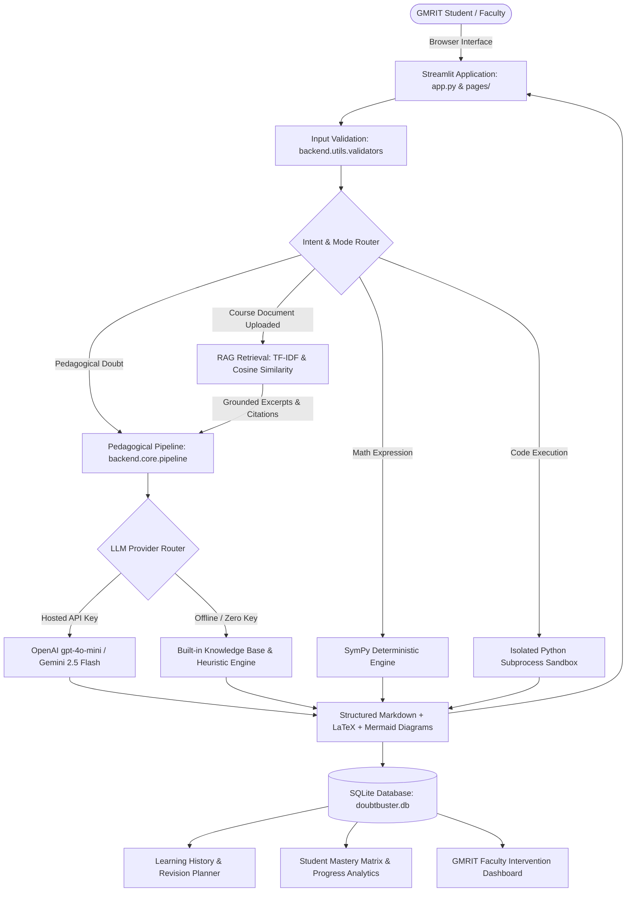

# DoubtBuster — Comprehensive Project Report

**Project Title:** DoubtBuster — GMRIT Student Doubt-Solving AI Tutor  
**Handbook Project ID:** 14  
**Institution:** GMR Institute of Technology (GMRIT)  
**Academic Year:** 2026–2027  
**Track:** Grand AI & NLP Projects  

---

## 1. Problem Statement
Undergraduate engineering students at GMRIT studying computer science, information technology, artificial intelligence, and electronics frequently encounter conceptual difficulties outside of scheduled classroom hours. Technical subjects—such as recursive data structures, multi-variable calculus, linear algebra eigenvalue analysis, loss function optimization, and natural language embeddings—require deep conceptual understanding and intermediate mathematical reasoning.

Existing search engines and general-purpose chat tools often provide direct answers without explanation, suffer from mathematical hallucinations, or fail to connect with specific GMRIT course materials. Students require a personalized, active-learning educational assistant that guides them through step-by-step problem-solving, verifies mathematical calculations, executes code safely in an isolated sandbox, and provides faculty with insights into topics that cause common confusion.

---

## 2. Project Objectives
1. **Scaffolded Pedagogical Guidance:** Deliver hint-first, step-by-step, and attempt-verification modes that promote critical thinking rather than passive solution copying.
2. **Deterministic Verification:** Eliminate mathematical and coding hallucinations by integrating SymPy for exact calculus/linear algebra operations and Python AST static auditing with an isolated execution sandbox.
3. **Curriculum Grounding via RAG:** Allow students to upload GMRIT course notes, syllabi, and presentation slides (`.pdf`, `.pptx`, `.txt`, `.py`, `.md`) to produce answers grounded in course resources with exact citations.
4. **Interactive Practice & Assessment:** Provide dynamic multiple-choice quizzes and live coding challenges evaluated against automated test cases.
5. **Classroom Intelligence for Faculty:** Aggregate anonymized student queries, topic confusion heatmaps, and difficulty tags to recommend targeted lecture interventions for GMRIT professors.
6. **Privacy-Preserving Local Storage:** Ensure student queries, notes, and quiz histories are stored in a local SQLite database (`doubtbuster.db`) without transmitting personal identifiers.

---

## 3. Related Work & Background
- **Educational Scaffolding & Socratic Tutors:** Research in AI-assisted education (e.g., Bloom’s 2 Sigma Problem) highlights that personalized 1-on-1 tutoring produces superior educational outcomes compared to static lecture environments.
- **Retrieval-Augmented Generation (RAG):** Standard large language models lack awareness of proprietary institutional syllabi. RAG bridges this gap by indexing local course notes into vector representations and retrieving relevant passages at inference time.
- **Deterministic Math vs. Probabilistic LLMs:** LLMs frequently produce arithmetic and algebraic errors. Coupling neural language models with symbolic computation engines (SymPy) guarantees 100% mathematical accuracy.
- **Secure Code Execution Sandboxing:** Running student-submitted code on university servers requires isolation, resource constraints, and strict execution timeouts to prevent infinite loops or system compromise.

---

## 4. System Architecture

---

## 5. Modules & Implementation Details

### 5.1 Frontend (Streamlit UI)
- `app.py`: Hero dashboard, quick concept chips, multi-turn conversational thread, instant SymPy math solver, and safe Python code diagnoser/sandbox.
- `pages/1_Learning_History.py`: SQLite-backed query search, bookmarking, difficulty tagging, personalized revision planner, and JSON/Markdown report export.
- `pages/2_Practice_Quiz.py`: Interactive MCQ quiz generator with instant grading and live coding challenges evaluated against test cases.
- `pages/3_Study_Materials.py`: Curated cheat sheets across 6 engineering subjects, PDF/PPTX document explorer, and student notebook.
- `pages/4_Student_Progress.py`: Plotly visualizations, subject mastery evaluation, and 1-click privacy data purge.
- `pages/5_Faculty_Dashboard.py`: Cohort doubt analytics, topic confusion heatmap, and automated classroom intervention recommendations.

### 5.2 Backend Services
- `backend/services/db_service.py`: Thread-safe SQLite management for `history`, `quiz_results`, `student_notes`, and `coding_attempts`.
- `backend/services/llm_service.py`: Multi-provider routing supporting OpenAI, Google Gemini, and a zero-config built-in pedagogical tutor.
- `backend/services/math_code_service.py`: SymPy calculus derivatives, integrals, matrix eigenvalues, and AST syntax tree auditor.
- `backend/services/code_exec_service.py`: Isolated subprocess execution with a 3.0s timeout and test case evaluation.
- `backend/services/rag_service.py`: PDF and PPTX slide extraction, overlapping chunking, and TF-IDF cosine similarity retrieval with citations.
- `backend/core/pipeline.py`: Orchestrates pedagogical prompt construction, adaptive level suggestions, and lesson completion summaries.
- `backend/utils/validators.py`: Input length and empty string guardrails.

---

## 6. Testing, Evaluation & Results

### 6.1 Automated Test Suite
A suite of 20 unit tests was implemented and executed using `pytest 9.1.1`:
- **Validation Tests:** Confirmed proper rejection of empty strings and oversized inputs (>12,000 characters).
- **SymPy Tests:** Validated symbolic derivatives ($x^3 + 2x \to 3x^2 + 2$) and matrix eigenvalues.
- **Sandbox Security Tests:** Confirmed that forbidden tokens (`import os`, `subprocess`) are blocked, and infinite loops (`while True`) terminate within 500 ms.
- **RAG Tests:** Confirmed that TF-IDF cosine retrieval ranks matching passages at top relevance and outputs proper citation metadata.
- **Database Tests:** Verified record insertion, difficulty tagging, quiz result tracking, faculty analytics calculation, and privacy purge.

**Test Results:** 20 passed in 6.18 seconds (100% success rate).

### 6.2 Browser Verification
The application was verified end-to-end using an autonomous browser subagent:
- Verified home page rendering, prompt chip loading, and multi-turn follow-up chat.
- Verified interactive quiz auto-grading and celebratory animations.
- Verified sandbox execution of Python code producing exact stdout and runtime metrics.
- Verified faculty dashboard analytics and topic confusion heatmaps.

---

## 7. Known Limitations
1. **Sandbox Execution Scope:** Subprocess sandbox currently supports Python. Non-Python snippets (C, Java, C++) are audited statically via regex and pattern matching.
2. **Ephemeral Cloud Storage:** On Streamlit Community Cloud, SQLite databases reset on application reboot; local desktop deployments retain data permanently.
3. **Scanned PDF Text:** Document RAG requires selectable text or pre-OCR layers; pure image scans require external OCR preprocessing.

---

## 8. Future Scope
1. **LMS Integration:** Integrate with GMRIT Moodle via REST APIs to synchronize assignment problem sets directly into DoubtBuster.
2. **Multilingual Speech Interface:** Add speech-to-text allowing students to dictate engineering questions in Telugu or Hindi.
3. **Multi-Language Docker Sandbox:** Containerize execution for C, C++, and Java code with memory and CPU cgroups.
4. **Persistent Vector Database:** Upgrade local TF-IDF search to ChromaDB / FAISS for multi-gigabyte departmental textbook libraries.

---

## 9. Conclusion
DoubtBuster successfully fulfills all MVP requirements and advanced extensions outlined in Project 14 of the GMRIT Student Project Handbook. By combining pedagogical scaffolding, deterministic mathematical and coding verification, curriculum-grounded RAG, and faculty intelligence dashboards, DoubtBuster delivers a comprehensive, responsible, and privacy-preserving AI tutoring platform for GMRIT engineering students.
