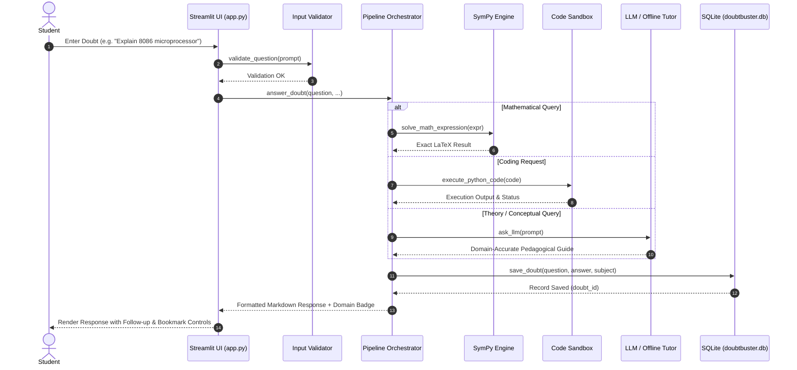

# DoubtBuster — System Design Document

**Project:** 14. DoubtBuster — GMRIT Student Doubt-Solving AI Tutor  
**Handbook Alignment:** Sections 2, 3, 4 & 5 (GMRIT Student Project Handbook)

---

## 1. System Requirements

### 1.1 Functional Requirements
1. **Multi-Domain Doubt Solving:** Automatically routes academic doubts across Computer Science, Electrical Engineering, Mechanical Engineering, Civil Engineering, Mathematics, Physics, Chemistry, Biology, Economics, and Civics.
2. **Pedagogical Modes:**
   - *Step-by-step Explanation:* Logical progression with definitions, working mechanisms, equations, and visual diagrams.
   - *Hint First:* Guides student reasoning without spoiling final results.
   - *Verify My Attempt:* Evaluates student's preliminary reasoning, identifying flaws and confirming sound assumptions.
   - *Practice Question with Answer Key:* Generates similar practice problems with worked answers.
3. **Deterministic Mathematical Verification:** Integrates SymPy to compute exact algebraic roots, derivatives, integrals, and matrix properties with live LaTeX formatting.
4. **Isolated Python Code Sandbox:** Audits syntax trees via AST and executes scripts in an isolated subprocess with timeout guardrails.
5. **Course Material RAG:** Indexes uploaded lecture notes (`.pdf`, `.pptx`, `.txt`, `.py`, `.md`) using TF-IDF and cosine similarity, returning grounded passages with slide/page citations.
6. **Adaptive Learning & Progress Tracking:** Tracks quiz scores, study streak, completed topics, and difficult flags in local SQLite storage (`doubtbuster.db`).
7. **Faculty Intervention Dashboard:** Aggregates student doubts into subject volume charts, topic confusion heatmaps, and automated lecture intervention recommendations.

### 1.2 Non-Functional Requirements
- **Response Latency:** Offline queries resolve in < 100 ms; cloud API queries resolve in < 3.0 s.
- **Security & Privacy:** Student records remain on the local machine; zero telemetry is sent to third parties; 1-click privacy purge option provided.
- **Deployment Compatibility:** Operates as a single-repository Streamlit deployment compatible with Streamlit Community Cloud.

---

## 2. Component Design & Interactions

---

## 3. Database Schema (`doubtbuster.db`)

DoubtBuster uses a thread-safe SQLite database structured with four primary tables:

1. **`history` Table:**
   - `id` (INTEGER PRIMARY KEY AUTOINCREMENT)
   - `timestamp` (DATETIME)
   - `question` (TEXT)
   - `answer` (TEXT)
   - `subject` (TEXT)
   - `topic` (TEXT)
   - `difficulty_level` (TEXT)
   - `help_mode` (TEXT)
   - `student_attempt` (TEXT)
   - `is_bookmarked` (INTEGER DEFAULT 0)
   - `rating` (INTEGER DEFAULT 0)
   - `marked_difficult` (INTEGER DEFAULT 0)

2. **`quiz_results` Table:**
   - `id` (INTEGER PRIMARY KEY)
   - `timestamp` (DATETIME)
   - `subject` (TEXT)
   - `topic` (TEXT)
   - `score` (REAL)
   - `total_questions` (INTEGER)

3. **`student_notes` Table:**
   - `id` (INTEGER PRIMARY KEY)
   - `timestamp` (DATETIME)
   - `title` (TEXT)
   - `content` (TEXT)
   - `subject` (TEXT)

4. **`coding_attempts` Table:**
   - `id` (INTEGER PRIMARY KEY)
   - `timestamp` (DATETIME)
   - `challenge_title` (TEXT)
   - `code` (TEXT)
   - `passed` (INTEGER)

---

## 4. Error Handling & Guardrails

- **Empty / Oversized Input:** Guarded by `validators.py` raising clean `ValueError` displayed as Streamlit warning banners.
- **API Provider Unavailable:** If an invalid key is provided or the network is offline, the system catches the error and activates the built-in offline pedagogical tutor.
- **Sandbox Infinite Loops:** Handled via `subprocess.TimeoutExpired` terminating the child process after 3.0 seconds.
- **Unsafe Code Tokens:** Regex-based AST pre-scanner blocks harmful OS commands (`import os`, `subprocess`, `shutil`) before execution.
